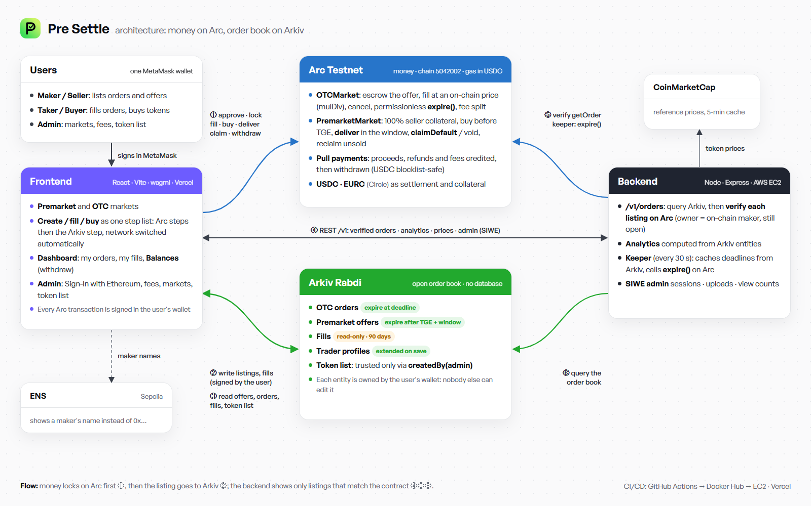

# Pre Settle

**Trustless OTC and pre-launch (premarket) trading, settled in stablecoins.**

- **Money** is locked in USDC/EURC escrow contracts on **Arc**.
- **Brokers** are verified with **ENSv2** names.
- **The order book** is open, wallet-owned data on **Arkiv**.

> Built at **ETHGlobal Mumbai 2026**.

## Architecture

1. Users lock, fill, buy, deliver, claim and withdraw on **Arc** (USDC/EURC escrow); every transaction is signed in their own wallet.
2. The listing or fill record is then written to **Arkiv** by the same wallet, so the user owns it; it expires on its own at the deadline.
3. The frontend reads offers, orders, fills and the token list straight from Arkiv.
4. The **backend** serves verified orders, analytics, prices and admin sign-in: it queries Arkiv, checks every listing against the Arc contract, and runs the **keeper** that calls `expire()` after deadlines.

Diagram source: [docs/diagram/architecture.html](docs/diagram/architecture.html).

## Status

🚧 In progress. The frontend, backend and escrow contracts are live on testnet. See [docs/CONTRACT_INTERFACE.md](docs/CONTRACT_INTERFACE.md) for what the app expects from them, and [docs/DEPLOYMENT.md](docs/DEPLOYMENT.md) for how everything is deployed.

## Prize tracks

| Sponsor | Prize |
|---|---|
| Arc | Best Smart Contracts with Advanced Stablecoin Logic, In Arc Studio |
| ENS | Best Use of ENSv2 |
| Arkiv | Build on Arkiv (from scratch) |

## Repository layout

| Folder | What it holds |
|---|---|
| [contracts/](contracts/) | Solidity contracts, built in Arc Studio and deployed to Arc Testnet |
| [frontend/](frontend/) | React + Vite + wagmi web app |
| [backend/](backend/) | Slim Node service: order verification, keeper, broker admin |
| [ens/](ens/) | ENSv2 setup scripts (Sepolia) |
| [scripts/](scripts/) | Arkiv seed and query scripts |
| [arkiv/](arkiv/) | Arkiv judging documents |
| [docs/](docs/) | Build plan, architecture, [deployment guide](docs/DEPLOYMENT.md) |

## Links

| | |
|---|---|
| Live demo | https://presettle-ethglobal.vercel.app |
| Backend API | https://3.109.65.92.nip.io/v1 ([health](https://3.109.65.92.nip.io/health)) |
| Arc Studio project | _TBD_ |
| Demo video | _TBD_ |
| OTCMarket (Arc Testnet) | [`0xB7c66d9136C5D6941467CC5B541b7272328DC17c`](https://explorer.testnet.arc.io/address/0xB7c66d9136C5D6941467CC5B541b7272328DC17c) |
| PremarketMarket (Arc Testnet) | [`0xB26990f986533AD138F70fc160a698Dd5E35Abf0`](https://explorer.testnet.arc.io/address/0xB26990f986533AD138F70fc160a698Dd5E35Abf0) |
| Arkiv query judges can run | `cd backend && npm install && node scripts/arkiv-query.js` |
| Arkiv writer wallets | _TBD_ |

## AI usage

- Built with the help of **Claude Code** (Anthropic) as a coding assistant.
- Smart contracts are written, tested and audited in **Arc Studio** (Circle's AI agent).

## License

[MIT](LICENSE)
