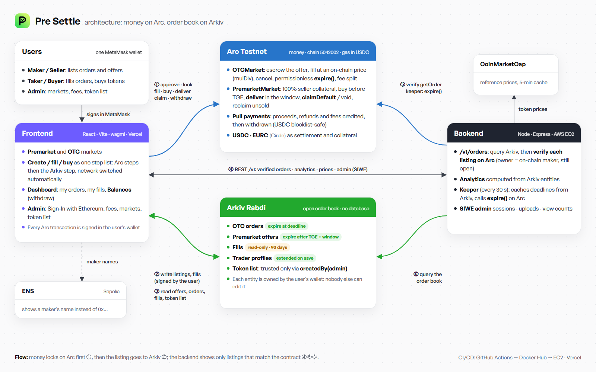

# docs

| File | What it is |
|---|---|
| [architecture.png](architecture.png) | Architecture diagram: Arc (money), Arkiv (order book), backend (verification, keeper), frontend |
| [DEPLOYMENT.md](DEPLOYMENT.md) | How the frontend (Vercel), backend (AWS EC2 via GitHub Actions) and contracts (Arc Testnet) are deployed, with every setting |
| [CONTRACT_INTERFACE.md](CONTRACT_INTERFACE.md) | The contract functions, structs and events the frontend, backend and keeper call, and the behaviour they rely on |
| [PLAN.md](PLAN.md) | The original build plan written at the start of the hackathon. Some parts changed during the build; the code and the other docs are the current reference |

